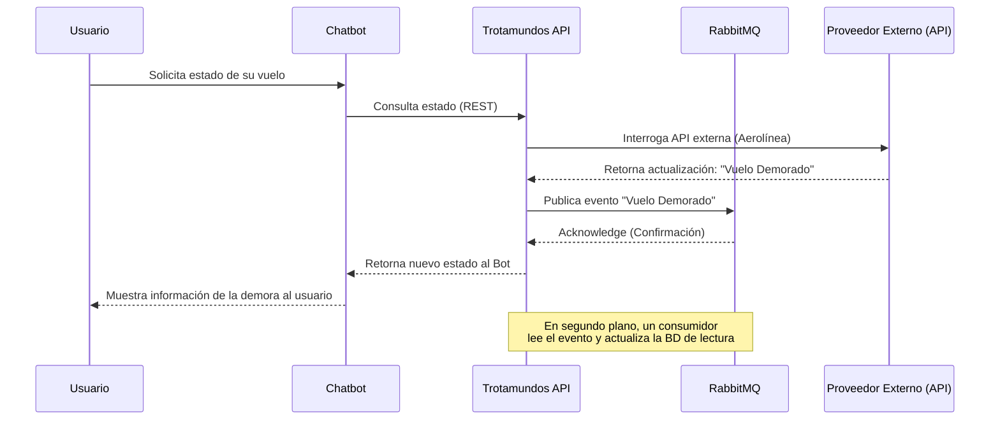

# ADD Iteración 4: Estrategia de Despliegue y Asistente Virtual

## 1. Objetivo de la Iteración
La iteración final se centra en cumplir las estrictas metas operativas: mantener el sistema funcionando ininterrumpidamente (solo 5 min de caída permitida) y manejar 2 millones de usuarios absorbiendo picos repentinos. Además, se detalla la orquestación del Chatbot.

## 2. Selección de Drivers Arquitectónicos
*   **QA1 - Escalabilidad:** Dimensionado masivo y picos por disrupciones climáticas.
*   **QA3 - Disponibilidad:** 99.988% de Uptime.
*   **UC5 - Ciclo de Vida:** Archivado automático de viajes completados.
*   **UC8 (Avanzado) - Asistente Virtual:** Soporte y derivación a agencia humana.

## 3. Conceptos de Diseño Seleccionados

1.  **Orquestación de Contenedores (Kubernetes):** Para lograr resiliencia y auto-escalado, todos los microservicios se empaquetarán en contenedores (Docker) y se desplegarán en un clúster de Kubernetes.
    *   Utilizaremos el **HPA (Horizontal Pod Autoscaler)** para crear nuevas instancias de los servicios (ej. el servicio de ingesta de correos) automáticamente cuando el tráfico aumente de golpe (picos climáticos).
    *   > *Ver [ADR-006: Estrategia de Despliegue mediante Kubernetes]*
2.  **Arquitectura del Asistente Virtual (Chatbot):** 
    *   El usuario se conecta al API Gateway vía **WebSockets** para tener comunicación bidireccional en tiempo real.
    *   El `Chatbot Service` procesa los mensajes mediante un motor de NLP. Si el nivel de confianza (confidence score) es bajo o el usuario pide hablar con un humano, el servicio despacha una llamada a la API de la "Agencia de Viajes Preferida", abriendo un ticket o derivando la sesión del chat a su sistema.
3.  **Procesos Cron / TTL (Time To Live) para el Ciclo de Vida (UC5):** 
    *   Para archivar viajes, se utilizará un `CronJob` en Kubernetes que se ejecute a medianoche (hora de cada zona), escaneando los viajes cuya fecha de finalización ya pasó. Emitirá un evento `ViajeCompletado`.
    *   Alternativamente, para datos cacheados o en bases de datos NoSQL, se utilizarán índices TTL para que los datos "viejos" se muevan automáticamente a un almacenamiento "Cold" (archivo).

## 4. Conclusión del Diseño
Con estas 4 iteraciones de ADD, hemos establecido una Arquitectura de Microservicios orientada a Eventos (EDA) con patrones de segregación de datos (CQRS). El sistema está diseñado para escalar elásticamente, soportar desarrollo colaborativo riguroso (Spec-Driven) y garantizar la seguridad mediante autorización delegada.

