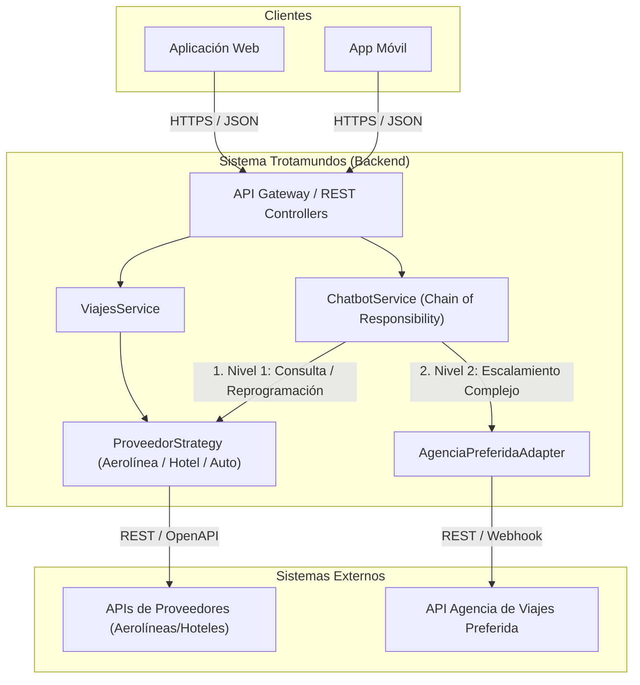
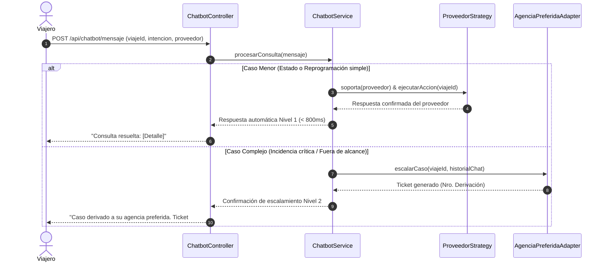

## Iteración 5: Incorporación del Módulo Avanzado - Asistente Virtual (Chatbot)

### 1. Objetivo de la Iteración
Abordar el requerimiento funcional avanzado obligatorio (**Opción B: Asistente Virtual**) asegurando el cumplimiento de los atributos de calidad de **Latencia (< 800ms)**, **Interoperabilidad** y **Evolucionabilidad**.

### 2. Selección de Elementos y Tácticas Arquitectónicas
* **Elemento a refinar:** `Trotamundos Backend` (Capa de Servicios de Negocio e Integración).
* **Tácticas aplicadas:**
  * *Encapsular / Usar intermediario (Interoperabilidad y Evolucionabilidad):* Uso de `AgenciaPreferidaAdapter` para abstraer los protocolos de las distintas agencias de viajes al momento de escalar tickets complejos.
  * *Diferir en el tiempo / Procesamiento acotado (Rendimiento):* Resolución síncrona rápida para consultas de primer nivel mediante estrategias en memoria y derivación asíncrona de contexto completo cuando se escala a soporte humano.
* **Patrones de Diseño:** *Chain of Responsibility* (evaluación de complejidad del reclamo) + *Strategy* (ejecución sobre proveedores).

### 3. Resumen de Cambios en Vistas
* Se incorpora el componente `ChatbotService` expuesto vía `/api/chatbot`.
* Se conecta `ChatbotService` con el componente existente `GestorEstrategiasProveedor` (para nivel 1) y con el nuevo componente `AgenciaPreferidaAdapter` (para nivel 2).

