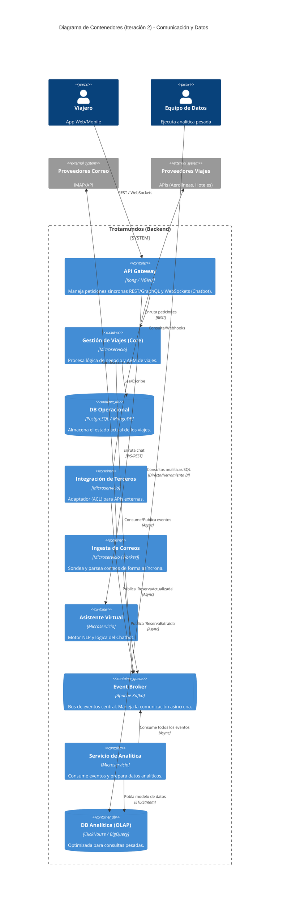

# ADD Iteración 2: Patrones de Comunicación y Gestión de Datos

## 1. Objetivo de la Iteración
El objetivo de esta iteración es definir cómo se comunicarán los microservicios internamente y cómo se gestionarán los datos para aislar las cargas de trabajo operacionales (usuarios consultando viajes) de las cargas analíticas (equipo de datos).

## 2. Selección de Drivers Arquitectónicos
*   **QA2 - Rendimiento:** Tiempo de respuesta web < 800ms. Las novedades de proveedores deben verse en la app en < 5 minutos.
*   **QA4 - Interoperabilidad:** Integración fluida y constante con proveedores externos.
*   **UC7 - Analítica de Datos:** Consultas analíticas pesadas para monetización de datos.

## 3. Conceptos de Diseño Seleccionados

1.  **Arquitectura Orientada a Eventos (Event-Driven) para comunicación interna:** Los servicios no se llamarán entre sí sincrónicamente (REST) bloqueando hilos, sino que emitirán eventos a un Message Broker (ej. Apache Kafka o RabbitMQ). Esto absorbe los picos de tráfico.
    *   > *Ver [ADR-002: Patrón de Comunicación Asíncrona]*
2.  **Patrón CQRS (Command Query Responsibility Segregation):** Separaremos las bases de datos de escritura (operacionales) de las bases de datos de lectura (analíticas). El motor analítico consumirá eventos del broker para poblar su propia base de datos optimizada para lecturas (ej. Data Warehouse/OLAP).
    *   > *Ver [ADR-003: Aplicación de Patrón CQRS para Analítica]*
3.  **Polling Asíncrono / Webhooks para Integraciones:** Para lograr los 5 minutos de actualización (QA2), el *Servicio de Integración* suscribirá a Webhooks de las agencias/aerolíneas si es posible, o implementará un mecanismo de sondeo recurrente y optimizado.

## 4. Elementos Instanciados y Refinamiento (Diagrama de Contenedores)

## 5. Próximos Pasos
En la Iteración 3, profundizaremos en el **Procesamiento de Correos (QA5 - Seguridad)** para manejar credenciales de forma segura, y en cómo el prototipo será testeado garantizando el contrato de las APIs usando Spec-Driven Development.