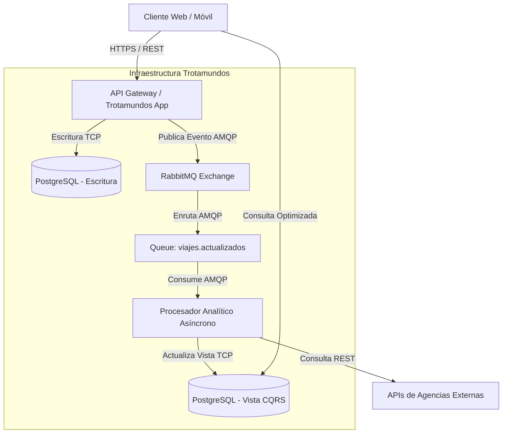

# ADR 002: Uso de Event-Driven Architecture para Comunicación Interna

* **Estado:** Aceptado
* **Fecha:** \[Fecha actual\]

## Contexto y Declaración del Problema
Con una arquitectura de microservicios, los servicios (Ej. Ingesta de Correos, Integración de Terceros, Gestión de Viajes) necesitan compartir datos. Las integraciones de terceros y escaneos de correo producirán nuevas reservas. Si utilizamos comunicación sincrónica (HTTP/REST) entre servicios, corremos el riesgo de cascadas de fallos y cuellos de botella en el servicio "Core", afectando el tiempo de respuesta (QA2) y la tolerancia a fallos (QA3). 

## Drivers
* QA1: Soportar picos dramáticos de uso.
* QA2: Rendimiento < 800ms y actualizaciones rápidas sin bloquear procesos.
* QA3: Alta Disponibilidad.

## Decisión
Se implementará un patrón **Event-Driven Architecture (EDA)** utilizando un Event Broker (ej. Apache Kafka) como columna vertebral de comunicación entre microservicios (Core, Mail, Integración, Analítica).

## Consecuencias

* **Bien:** Desacoplamiento temporal. Si el servicio Core está caído, los correos procesados se encolan en Kafka y se procesan al volver.
* **Bien:** Soporta picos de tráfico extremos actuando como un "amortiguador" (buffer).
* **Bien:** Permite que nuevos servicios (ej. el servicio de Analítica) simplemente se suscriban a eventos ("ReservaCreada", "VueloCancelado") sin modificar el código de los publicadores (cumpliendo QA6 - Evolucionabilidad).
* **Mal:** Mayor complejidad en el rastreo (tracing) de transacciones distribuidas.
* **Mal:** Eventual consistency (consistencia eventual): los datos pueden tardar algunos milisegundos en reflejarse en las lecturas.

