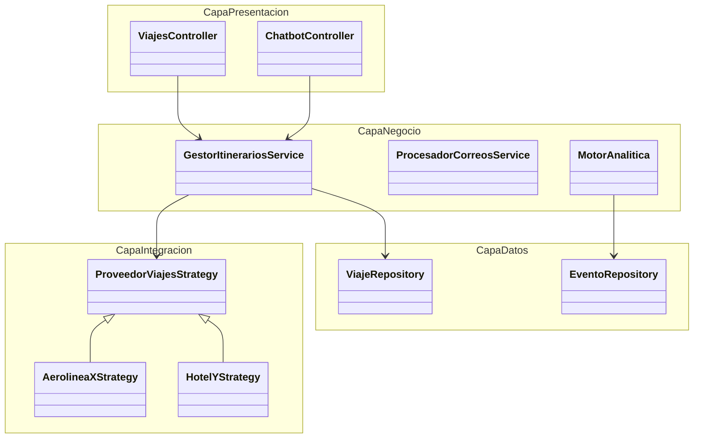

# ADR 005: Adopción de Spec-Driven Development (API-First)

* **Estado:** Aceptado
* **Fecha:** \[Fecha actual\]

## Contexto y Declaración del Problema
La consigna requiere enfáticamente un enfoque "Spec-driven" para asegurar que el prototipo sea trazable, consistente y facilite evaluaciones futuras (QA6). Al tener equipos distribuidos trabajando en diferentes microservicios, existe el riesgo de incompatibilidades en la comunicación (ej. el servicio web espera un campo `flight_id` y el microservicio envía `flightId`).

## Drivers
* QA6: Evolucionabilidad, mantenibilidad y trazabilidad estricta.

## Decisión
Se adopta un proceso **API-First**. Ningún código de un microservicio puede ser escrito sin que antes se apruebe su contrato formal.
* Para comunicaciones síncronas (REST): Se utilizará **OpenAPI Specification (OAS)**.
* Para comunicaciones asíncronas (Eventos): Se utilizará **AsyncAPI**.

El código de los controladores del servidor y los clientes (SDKs) para las integraciones se **autogenerará** a partir de estas especificaciones utilizando herramientas (ej. OpenAPI Generator).

## Consecuencias
* **Bien:** Garantiza que el código implementado cumple el contrato (Spec-driven).
* **Bien:** Permite a los equipos de frontend y backend trabajar en paralelo utilizando servidores "Mock" generados desde la especificación.
* **Mal:** Añade una sobrecarga (overhead) inicial en la fase de diseño para redactar y validar los contratos YAML/JSON.

