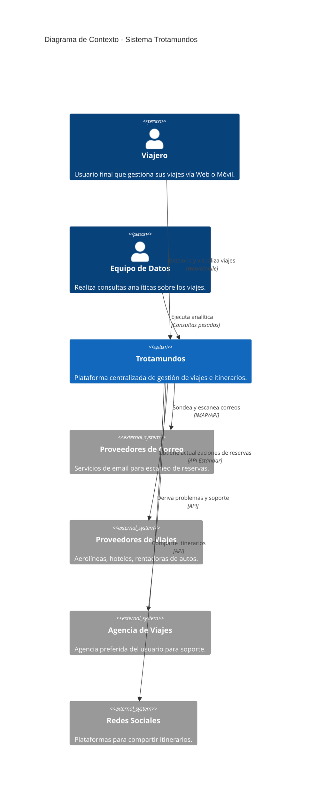
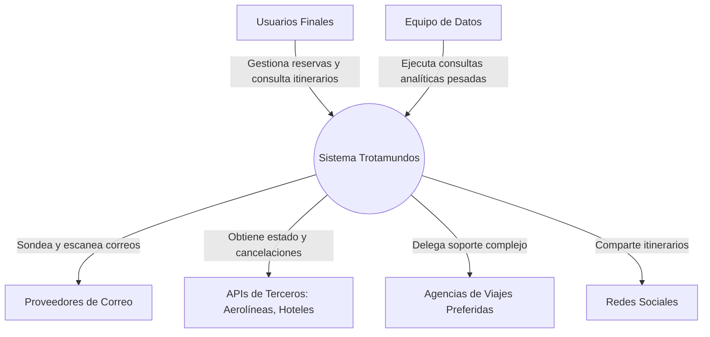

# Análisis Inicial y Pre-requisitos: Sistema "Trotamundos"

## 1. Alcance del Sistema y Actores Identificados

Antes de iniciar el proceso de diseño iterativo (ADD), definimos los límites del sistema identificando con quién o qué interactúa "Trotamundos".

**Actores Principales:**
* **Viajero (Usuario Final):** Interactúa con el sistema a través de interfaces Web y Móvil para gestionar su ciclo de vida de viajes.
* **Equipo de Datos:** Usuarios internos/analistas que ejecutan consultas pesadas para monetización de datos.

**Sistemas Externos:**
* **Proveedores de Correo Electrónico:** Plataformas (ej. Gmail, Outlook) de las cuales el sistema sondea y escanea correos para extraer reservas.
* **Sistemas de Terceros (Proveedores de Viajes):** APIs de aerolíneas, hoteles, y rentadoras para obtener detalles, actualizaciones y cancelaciones.
* **Agencia de Viajes Preferida:** Sistema externo al que se deriva la resolución rápida de problemas del usuario.
* **Redes Sociales:** Plataformas externas utilizadas para compartir los itinerarios de forma segura.

## 2. Diagrama de Contexto (C4 Model)

## 3. Drivers Arquitectónicos (Architecturally Significant Requirements - ASRs)

Para guiar las iteraciones de ADD, priorizamos los siguientes requerimientos como inmutables.

### 3.1. Atributos de Calidad Críticos (Quality Attributes)
1. **QA1 - Escalabilidad:** Soportar 15 millones de cuentas, 2 millones de usuarios activos semanales y picos dramáticos (jueves-viernes, domingo-lunes y disrupciones climáticas).
2. **QA2 - Rendimiento:** Web: 800ms de tiempo de respuesta. Móvil: First-contentful paint < 1.4s. Sincronización: Novedades externas visibles en < 5 minutos.
3. **QA3 - Disponibilidad:** Máximo 5 minutos por mes de inactividad no planificada (aprox. 99.988% de Uptime). Uso global 24/7.
4. **QA4 - Interoperabilidad:** Integración estándar e impecable con APIs de terceros (viajes, correos, redes sociales).
5. **QA5 - Seguridad:** Acceso seguro/autorizado a correos, privacidad de datos personales y compartición controlada de itinerarios.
6. **QA6 - Evolucionabilidad:** Arquitectura preparada para futuras integraciones (ej. trenes, autobuses) con alta trazabilidad (Spec-driven/ADRs).
7. **QA7 - Usabilidad e i18n:** Interfaz nativa (uso de GPS) y preparación arquitectónica multiregión (internacionalización).

### 3.2. Requerimientos Funcionales Priorizados (Casos de Uso Principales)
* **UC1 - Procesamiento Automático:** Sondear y escanear correos para agregar reservas.
* **UC2 - Filtros y Whitelists:** Gestión de remitentes seguros para el escaneo.
* **UC3 - Integración Fluida:** Obtener detalles y cancelaciones desde APIs de terceros.
* **UC4 - Gestión Manual:** ABM manual de reservas por el cliente.
* **UC5 - Ciclo de Vida:** Agrupación por viaje y archivado automático post-viaje.
* **UC6 - Soporte:** Derivación de problemas a agencias preferidas.
* **UC7 - Analítica:** Recopilación y consulta pesada de datos de tendencias.

